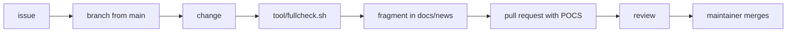

# Contributing

Keep it simple. Mandrake does three things (trim, measure, rebuild a `~/.claude`), and a change earns its place by making one of them better for someone using it.

## The flow



1. Open or pick an issue; an epic groups several.
2. `git switch -c <you>/<short-name> origin/main`, change what the issue asks, nothing else.
3. `tool/fullcheck.sh` until it says `everything passed`.
4. One line in `docs/news/<issue>.<type>.md`, the way it should read in the changelog.
5. Open the pull request from the template: `Closes #<issue>`, a `[POCS]` line, the checks you ran, its labels; then `tool/board.sh sync` and `tool/board.sh check`.

## The rules

- **Start from an issue.** One change is one issue; several independent items are an epic with one sub-issue each. The pull request starts with `Closes #<sub-issue>. Part of #<epic>.` and follows the template.
- **No agent instruction files.** No `AGENTS.md`, `CLAUDE.md`, `GEMINI.md`, `.cursorrules` or the like ([ADR-0004](docs/adr/workflows/0004-no-agent-instruction-files.md)). The code, `docs/`, the ADRs and the changelog are the context, for people and agents alike.
- **Code files stay under 639 lines.** Data formats (JSON, JSONL, TOML catalogs, lockfiles, SVG, logs) are exempt.
- **Run the gate before pushing:** `tool/fullcheck.sh`. There is no CI for now: this script is the gate.
- **Add a news fragment** in `docs/news/<issue>.<type>.md`: one line, written as the changelog entry, with a type of `added`, `changed`, `removed`, `fixed` or `security`; `+<name>.<type>.md` when there is no issue. Never edit `docs/CHANGELOG` by hand. A change nobody using Mandrake would notice takes the `skip-news` label instead.
- **Write an ADR** in `docs/adr/` when a choice has trade-offs someone will ask about ([how](docs/adr/README.md)). Architecture lives in [`docs/ATLAS.toml`](docs/ATLAS.toml); the names and abbreviations in [`docs/TERMS.md`](docs/TERMS.md).
- **Show it working.** A `[POCS]` line in the pull request says where the change can be seen; test evidence from a terminal goes as anina recordings, embedded one per line.
- **Sign your commits**, in plain English. The maintainer merges, after review.

## Labels and the board

Every issue and pull request carries **one type**, the same word as its commit prefix, and **every area** it touches. The list, with colors and meanings, is [`.github/labels.tsv`](.github/labels.tsv); a label enters there first.

| Type | Commit prefix | Areas, by path |
| - | - | - |
| `bug` · `enhancement` · `documentation` · `test` · `refactor` · `ci` | `fix` · `feat` · `docs` · `test` · `refactor` · `chore` | `cli` · `tui` · `proxy` · `meter` · `layout` · `plugins` · `shell` |

An epic adds `epic`; a report from testing, `feedback`. Each item goes on the [board](https://github.com/users/brennercruvinel/projects/8): Done when closed or merged, In progress once part of it has landed. Every closed issue is linked: one keyword per number (`Closes #25, closes #30`; GitHub closes only the first of `Closes #25 #30`), a sub-issue is attached to its epic, and a pull request with no issue says `No issue: <why>`.

```sh
tool/board.sh labels   # .github/labels.tsv to GitHub
tool/board.sh sync     # every issue and pull request on the board, with its status
tool/board.sh check    # what is off the standard; exits 1 when there is anything
```

## The records, checked

The ADRs in force, the changelog drafted from the fragments, and `towncrier check` passing with a fragment and failing without one (`tool/tests/e2e/anina/records/check.sh`):



## Setup

Rust (rustup.rs), then `cargo build --workspace` and `cargo test --workspace`. How Mandrake works for someone using it is in [`docs/guide/how-it-works.md`](docs/guide/how-it-works.md).
