# Mandrake ~ The AI safety killer

A middleman to cut the bullshit that gets in the way of model performance: stupid guardrails, useless instructions, and all that jazz.

Mandrake trims the context Claude Code injects into your prompt and intercepts API requests through a local proxy, including OpenCode sessions backed by Claude Code. Request diffs, live inspection, and token usage show what changed and how much you saved.

It also reorganizes your ~/.claude folder, centralizing configs, plugins, and prompts, making your setup portable across Mac and Linux machines and your agent trajectories easier to reuse for research, ML training, and custom harnesses.

And then there are souls: a way to invoke agents with their own identity, context, and settings across different CLIs.

## Install

macOS and Linux. Requires [Rust](https://rustup.rs) and at least one supported agent CLI. Context trimming and measurement target Claude Code.

```sh
git clone git@github.com:brennercruvinel/mandrake.git && cd mandrake
./install.sh --cli
exec $SHELL
mandrake doctor
```

The setup adds `~/.local/bin` to `PATH`. Keep using your CLI as usual.

## Setup

`mandrake setup` configures your development directory, plugins, proxy, and prompts. Keep, link, or copy each entry in `~/.claude` through a reusable profile.


## See the cut

### `mandrake compare`

Run the same prompt with and without Mandrake. Compare the system prompt, tools, and messages side by side. Both runs use a local API stub: no login or external API requests required.



### `mandrake watch`

Monitor requests and token usage as they pass through the local proxy.



### `mandrake hex`

Inspect captured request bodies before and after trimming. Use `mandrake hex <id>` to open a specific request listed by `mandrake audit`.



### `mandrake bench --view`

Run `mandrake bench` to measure token savings with real A/B requests (two per prompt). Use `--view` to open the latest report.


## Souls

```sh
claude invoke <soul>
codex invoke <soul>
opencode invoke <soul>
```

Each soul has its own prompt, settings, environment, and GitHub CLI login when configured. To bind a session opened without a soul, use `/invoke <soul>` (`$invoke` in Codex).

## Commands

| Command | Description |
| --- | --- |
| `mandrake doctor` | Check links, settings, plugins, shell, and proxy |
| `mandrake capture` | Capture the current `~/.claude` layout as a profile |
| `mandrake link plan\|apply\|rollback` | Preview, apply, or undo filesystem changes |
| `mandrake proxy run\|install\|uninstall\|status` | Manage the local proxy |
| `mandrake audit` | List requests with captured bodies |

Filesystem changes are journaled. Replaced files are backed up under `~/.local/state/mandrake/backups/` by default. Run `mandrake link rollback` to undo the last apply.

## Layout

```text
rust/    CLI, home, layout, meter, proxy, TUI
cfgs/    filesystem catalog, trim rules, services, shell launcher
data/    plugins (prompt-trim, fancy, tui-embed), core prompt, souls, skills
docs/    guides, ADRs, audits, plans, demos, evidence, ATLAS.toml,
         TERMS.md, CHANGELOG
tool/    E2E tests, anina tapes, fixtures, demo recordings
```

## Documentation

- [How it works](docs/guide/how-it-works.md)
- [Contributing](CONTRIBUTING.md)

----

<details>

Copyright [Hoff Research](https://hoffresearch.com)
Made it simple, but significant (∂μFμν = Jν)
Brenner Cruvinel

</details>
