# Mandrake ~ The AI safety killer

A middleman to cut the bullshit that gets in the way of model performance: pointless guardrails, useless instructions, and all that jazz.

First, it sits between Claude Code and the API, trimming the redundant instructions and guardrails the CLI injects into your prompt, saving tokens and giving you more control.

Second, it lets you see what changed and what you saved: diffs, live inspection, byte-by-byte views.

Third, it reorganizes your ~/.claude folder, centralizing configs, plugins, and prompts, making your setup portable across Mac and Linux machines and your agent trajectories easier to reuse for research, ML training, and custom harnesses.

And then there are souls: a way to invoke agents with their own identity, context, and settings across different CLIs.


## Install

```sh
git clone git@github.com:brennercruvinel/mandrake.git && cd mandrake
./install.sh --cli     # builds, installs, then asks item by item what to do
exec $SHELL            # loads Mandrake in this terminal
mandrake doctor        # checks everything
```

Needs Rust ([rustup.rs](https://rustup.rs)) and Claude Code. The shell block setup writes also puts
`~/.local/bin` on `PATH`, so `mandrake` is found once `exec $SHELL` loads it. Then use `claude` as always.

### `mandrake setup`

One screen per step: your development folder, each entry of `~/.claude` (keep, link or copy),
plugins, the proxy, the prompts. Whatever is in the way goes to a backup first.



## See the cut

### `mandrake compare`

One prompt through your own Claude Code, without and with Mandrake, part by part: system prompt,
tools, messages. Both requests are answered locally, so nothing is spent and no login is needed.


### `mandrake watch`

Every request live as it goes through the proxy: without Mandrake on the left, with it on the right.


### `mandrake hex`

One request before and after the cut, byte by byte: the newest one, or `mandrake hex <id>` with an id
from `mandrake audit`.


### `mandrake bench --view`

The saving over fixed prompts. `mandrake bench` measures it with real requests (two short ones per
prompt); `--view` draws the last report.



## Everything else

| Command | Does |
| - | - |
| `mandrake doctor` | checks links, settings, plugins, shell and proxy |
| `mandrake capture` | writes the current `~/.claude` as a profile, to rebuild another machine |
| `mandrake link plan\|apply\|rollback` | the links, with backup and journal; nothing is deleted |
| `mandrake proxy run\|install\|uninstall\|status` | the local proxy that trims and measures |
| `mandrake audit` | requests whose bodies were kept |
| `claude invoke <soul>` | a session with a soul: the core prompt plus its own, its settings and gh login; `codex` and `opencode` take `invoke <soul>` too |
| `/invoke <soul>` | inside a session opened without a soul (an IDE, the app): binds it to that soul |

**If something breaks:** `mandrake link rollback` undoes the last apply, the originals wait in
`~/.local/state/mandrake/backups/`, and `mandrake doctor` says what is off.

## Layout

```
rust/    the Rust workspace: cli (the binary), home, layout, meter, proxy, tui
cfgs/    what the installer writes: the ~/.claude catalog, trim rules, services, the shell launcher
data/    what gets installed: plugins (prompt-trim, fancy, tui-embed), the core prompt, souls, skills
docs/    guide/ (how it works, setup, measure), adr/ (decisions), audit/ and plan/ (records),
         img/ (demos and evidence), ATLAS.toml, TERMS.md, CHANGELOG
tool/    tests outside cargo (e2e scripts, anina tapes, fixtures) and demo/ (these recordings)
```

Start with [docs/guide/how-it-works.md](docs/guide/how-it-works.md).

## Contributing

See [CONTRIBUTING.md](CONTRIBUTING.md): the flow on one screen, and what the gate checks.
