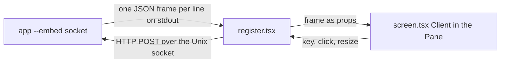

# TUI embed

A Claude Code mod that runs terminal apps inside panes, drawn by the apps themselves, with their own keys and clicks, beside the conversation:

| Command | App | What it shows |
| - | - | - |
| `/abtop` | [abtop](https://github.com/graykode/abtop) | Every Claude Code, Codex CLI and OpenCode session on this machine |
| `/gitlogue [path] [options]` | [gitlogue](https://github.com/unhappychoice/gitlogue) | The commits of a repository, the session's by default, replayed as typing |

Under abtop, a field sends a message to the Claude Code session selected in abtop, through the same channel as the SendMessage tool.

## How it works

Each app has an `--embed <socket>` mode that draws its real UI into an in-memory ratatui buffer. The mod shows each frame in a `Client` and sends input back.



| Piece | Role |
| - | - |
| `hooks/register.tsx` | The app table; spawns each app when its pane opens, keeps its latest frame in a `$.state` family keyed by pane, forwards input over its socket, stops it when the pane closes |
| `hooks/screen.tsx` | The `Client` surface module: draws the frame as colored `Text` runs, posts keys, left clicks and its size |
| `types/index.d.ts` | The frame format and the `$.state` contract |

### The embed protocol

A frame is one line of JSON on stdout:

```json
{"cols":90,"rows":30,"selected":null,"lines":[[["text","#rrggbb","",1], ...], ...]}
```

Each row is a list of style runs `[text, fg, bg, modifiers]`: `""` is the host's default color; modifier bits are bold 1, dim 2, italic 4, underline 8, reversed 16. `selected` is optional: abtop names the selected session there. Input is an HTTP POST on the socket with one JSON body: `{"type":"key","key":"j","shift":false,"ctrl":false}`, `{"type":"click","x":5,"y":4}` or `{"type":"resize","cols":90,"rows":30}`.

Adding an app means giving it that mode and one entry in the `apps` table of `register.tsx`.

## Use

Type `/abtop` or `/gitlogue`, then click inside the pane to give the app the keyboard; Esc gives it back to the prompt. In fullscreen from 110 columns the pane docks beside the transcript, otherwise it opens above the prompt.

The prompt keeps Esc for itself, so each pane has an `Esc no <app>` button that sends it to the app: gitlogue's menu, abtop's clear filter. `q` and ctrl+c are ignored inside the apps: a pane closes from its own mark.

| abtop | |
| - | - |
| `j` `k`, arrows, click | Select a session |
| Enter | Jump to its terminal tab (Terminal.app, iTerm2, tmux, cmux) |
| `x` `x` | Stop the selected session |
| `?` | Key reference |

`/gitlogue` takes gitlogue's own arguments; a first argument that is a path (starting with `/` or `.`) is the repository. Opening it again with other arguments restarts it:

```
/gitlogue /path/to/repo
/gitlogue --commit HEAD~5..HEAD --theme nord
/gitlogue diff
```

| gitlogue | |
| - | - |
| Space | Pause and resume |
| `h` `l`, `H` `L` | Step a line, a change |
| `p` `n` | Previous and next commit |
| `Esc no gitlogue` | Menu |

## Requirements

- abtop and gitlogue with `--embed` (macOS and Linux), from the forks: `cargo install --git https://github.com/tiamatio/abtop --branch embed --locked`, `cargo install --git https://github.com/tiamatio/gitlogue --branch embed --locked` (`mandrake setup` does this when tui-embed is chosen)
- Claude Code 2.1.296 or newer
- `abtop_path` and `gitlogue_path` in `/config` when a binary is not on `PATH`

## Install

```
claude plugin marketplace add /path/to/tui-embed
claude plugin install tui-embed@tui-embed --scope user
```

The marketplace source is `./`, so Claude Code reads the plugin from this folder in place: an edit applies in a new session or after `/reload-plugins`.

## Develop

```
claude plugin validate --strict .
claude plugin test .
tsc -p .            # needs .claude-plugin/types/, written when a session loads the plugin
```

## Limits

- The `Client` pointer API has no wheel events, so the mouse wheel does not scroll
- Clicks reach the pane where the terminal reports them, the fullscreen layout
- A frame travels as `Client` props, at most 100,000 characters: about 11,000 for abtop at 90x30, 7,000 for gitlogue
- Like its TUI, abtop generates session titles with `claude --print`, which uses Claude quota
- A socket left in `/tmp` by a killed app is removed on the next start
