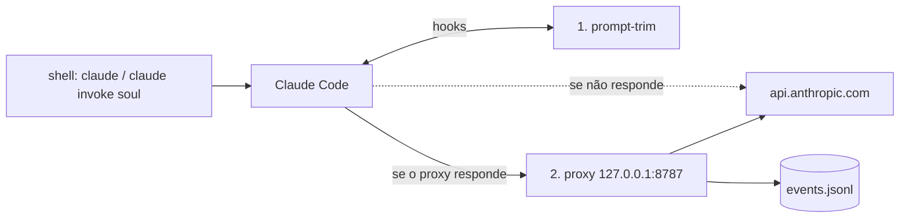

# Como funciona

Toda vez que você manda uma mensagem, o Claude Code envia para a API muito mais do que ela: um
system prompt próprio de alguns milhares de tokens, a descrição longa de cada tool, lembretes
automáticos, data, pasta, plataforma. Você paga esse pacote em toda requisição. O Mandrake corta
esse pacote em duas camadas e põe no lugar um core curto que devolve só as regras de trabalho.

## 1. prompt-trim, dentro do Claude Code

Um plugin carregado por `CLAUDE_CODE_PLUGIN_DIRS`. Age antes de a requisição existir:

| Tira | Põe no lugar |
| - | - |
| as seções do prompt padrão do Claude Code (`intro`, `doing_tasks`, `tools`, `tone`…) | o core, `data/prompt/cores/coding.md`, nas sessões sem soul |
| cerca de 75 tipos de lembretes e anexos (data, ambiente, todo, plano, modelo, idioma…) | nada; o core diz ao modelo que pergunte à máquina (`date`, `pwd`) |
| a descrição de cada tool (~16 mil caracteres) | o core resume os contratos que importam (Read antes de Edit, cuidados do Bash) |
| a lista de tipos de subagente | nada |

Reescreve os textos fixos dos anexos que ficam: `Contents of X (…):` vira `# X`, o cabeçalho da lista
de skills vira `Skills:`.

## 2. proxy local, entre o Claude Code e a API

Alcança o que o plugin não alcança, no corpo JSON da requisição:

- tira as tags `<system-reminder>` em volta dos textos, mantendo o conteúdo;
- tira os campos do topo listados em `[proxy] strip_fields` (padrão: `metadata`);
- mede: conta os tokens antes e depois (`count_tokens`, com a credencial da própria requisição),
  e guarda o `usage` que a API cobrou. Uma linha por requisição em `~/.local/state/mandrake/events.jsonl`.

O corte da identidade do CLI no `system` existe (`cut_identity`), mas vem desligado: medido numa
sessão longa com login por assinatura, ele fez a requisição custar mais (269.338 → 291.637 tokens).

O proxy é opcional para funcionar. O `settings.json` não aponta para ele: o launcher do shell
define `ANTHROPIC_BASE_URL` por sessão, só quando o proxy responde. Proxy fora do ar = sessão
direto na API, com um aviso. Sessões abertas fora desse shell (IDE, app) não passam pelo proxy,
mas continuam com o prompt-trim.

## Ver o corte

`mandrake compare` roda um prompt pelo seu Claude Code duas vezes, sem e com o Mandrake, e mostra lado a lado o que cada um enviaria: o system prompt, as ferramentas e as mensagens, com o tamanho de cada parte. As duas requisições vão para uma API falsa local, que responde na hora: nada chega à Anthropic e nada é gasto. `--print` imprime a tabela. Os dois corpos ficam em `state/compare/run-<data>` por um dia; o compare seguinte apaga as pastas mais velhas (as do bench, em `state/bench`, ficam sete dias).

## Quanto economiza, medido

`mandrake bench` roda os mesmos prompts pelo `claude -p`, com o seu login, sem Mandrake (sem
prompt-trim, proxy só medindo) e com ele. Em 2026-10-24, nesta máquina:

| prompt | tokens sem | tokens com | economia |
| - | -: | -: | -: |
| resposta-curta | 20.784 | 14.152 | 31,9% |
| pergunta | 20.791 | 14.159 | 31,9% |
| codigo | 20.801 | 14.169 | 31,9% |

Onde estão os tokens que sobram, na requisição com Mandrake: o `CLAUDE.md` do usuário (~18,8 mil
caracteres, o maior pedaço), o core (~4,4 mil), os schemas das tools sem descrição. O Mandrake não
corta o `CLAUDE.md`: ele é seu. O proxy sozinho corta pouco (17 tokens); quase toda a economia é do
prompt-trim.

## Souls

`claude invoke <soul>` abre uma sessão com o prompt da soul como system prompt inteiro, o
`settings.json` dela e o gh dela (`~/.config/gh-<soul>`). O core vai antes da soul, a menos que o
perfil diga `core_only_plain = true` (souls que já se sustentam sozinhas). `Rhizo` é o exemplo
que vem com o Mandrake.

## A pasta ~/.claude

Um perfil diz, para cada entrada de `~/.claude`, se ela fica, vira link para uma pasta sua ou
recebe uma cópia. Nada é apagado: o que está no caminho vai para
`~/.local/state/mandrake/backups/<data>/`, cada passo vai para um journal, `mandrake link rollback`
desfaz. `mandrake capture` escreve a pasta atual como perfil, para refazer outra máquina.

## Onde fica cada coisa

| | Padrão | Muda com |
| - | - | - |
| perfil | `~/.config/mandrake/mandrake.toml` | `XDG_CONFIG_HOME` |
| cópia instalada (`data/`, `cfgs/`) | `~/.local/share/mandrake/src` | `XDG_DATA_HOME` |
| eventos, bench, journal, backups, logs | `~/.local/state/mandrake` | `XDG_STATE_HOME` |
| tudo acima, para teste | | `MANDRAKE_HOME` |
