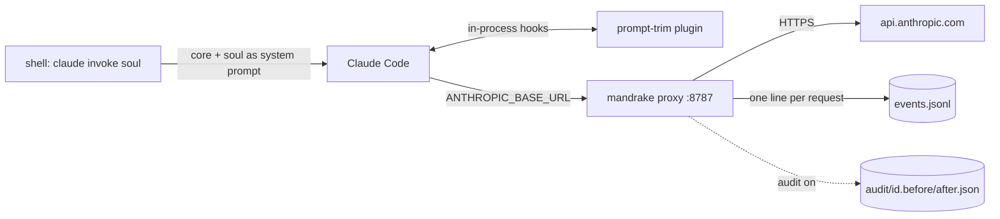

# How it works

Mandrake sits on the path a prompt takes from your terminal to the API, and cuts in two places.

| Layer | Runs | Cuts |
| - | - | - |
| `data/plugins/prompt-trim` | inside Claude Code, through its plugin module API, loaded by `CLAUDE_CODE_PLUGIN_DIRS` | default system prompt sections, about 75 kinds of attachments (date, environment, reminders…), tool descriptions, the subagent listing; rewrites the wrappers it keeps (`Contents of X:` becomes `# X`) |
| `pkgs/proxy` | a local process, as a user service (launchd or systemd) | what the plugin cannot reach: the CLI identity block in `system`, the `<system-reminder>` tags, top-level fields listed in the profile (`metadata` by default) |

The plugin acts before the request exists, so the proxy never sees what it removed. The proxy sees
both sides of its own cut, which is how `watch` and `bench` measure without running a session twice.

## What reaches the model

In a session opened with `claude invoke <soul>`:

| Part | Content |
| - | - |
| `system` | the core prompt (`data/prompt/cores/coding.md`, unless the profile says otherwise) followed by the soul's own prompt |
| `tools` | names and parameter schemas, no descriptions |
| first user message | `CLAUDE.md` as `# <path>`, the skill list, deferred tools, hook context, and `/invoke` expanded when that skill is on |
| gone | date, working directory, platform, model, language, output style, todo and plan reminders, the default Claude Code prompt, `metadata` |

The core exists because of that last row: it gives back, in one page, the working rules the default
prompt carried (read before editing, care with irreversible actions, git hygiene, verify by running)
and tells the model the environment block is gone, so it asks the machine instead of guessing.

## Measurement

Each `/v1/messages` request through the proxy writes one `mandrake_meter::Event`: bytes before and
after the cut, tokens before and after (two `count_tokens` calls off the response path, with the
request's own credential), the `usage` the API reported (input, output, cache read and create),
what was cut, status and time. A second proxy in `pass` mode writes the same events without cutting,
for an A/B.

## The Claude Code folder

`~/.claude` (or `CLAUDE_CONFIG_DIR`) is arranged by a profile: each entry stays, becomes a link to
your development folder, or gets a copy. Nothing is deleted: what is in the way moves to
`~/.local/state/mandrake/backups/<stamp>/`, every step goes to a journal, and `mandrake link rollback`
undoes the last apply. `mandrake capture` writes the current arrangement as a profile, so a machine
can be rebuilt from one file.

## Where things live

| | Default | Override |
| - | - | - |
| profile | `~/.config/mandrake/mandrake.toml` | `XDG_CONFIG_HOME` |
| installed copy of `data/` and `cfgs/` | `~/.local/share/mandrake/src` | `XDG_DATA_HOME` |
| events, audit, journal, backups, logs | `~/.local/state/mandrake` | `XDG_STATE_HOME` |
| everything above, for tests | | `MANDRAKE_HOME` |

The same paths on macOS and Linux; only the service differs (launchd, systemd --user).
